# jax-shapley

[FastSVERL](https://github.com/djeb20/fastsverl) (arXiv 2511.06094) ported from PyTorch and Gymnasium to end-to-end JAX and Flax NNX. The environments, DQN agents, and behaviour, prediction and outcome explanations (characteristic and Shapley models) each run as compiled JAX programs, every seed of a stage in one program. The goal is the paper's results in a fraction of the experiment time. The behavioural reference is FastSVERL commit `25b2cbe66b0d4a0decc3b63dbc798a79bf2c7d5b`.

## Speed

**Environments.** Transitions per second with 2,048 parallel environments (Hypercube 6×5 on Gymnasium: 16, the most the unmodified source fits in memory):

| Environment | Gymnasium, CPU | JAX, CPU | JAX, T4 GPU | JAX, TPU v5e-1 | JAX, RTX 4080 SUPER |
| --- | ---: | ---: | ---: | ---: | ---: |
| Gridworld | 216,064 | 8,988,350 | 107,244,581 | 57,352,678 | 164,905,947 |
| Hypercube 2×2 | 220,402 | 26,517,196 | 106,900,071 | 90,418,341 | 180,082,076 |
| Hypercube 6×5 | 210,675 | 18,873,044 | 107,032,719 | 90,377,460 | 178,706,862 |
| Mastermind-222 | 66,670 | 6,619,422 | 91,638,506 | 62,254,573 | 154,320,168 |

On the same CPU (Intel i9-14900K), JAX is 42–120× faster than Gymnasium; on a GPU or TPU it is 265–2,315× faster. The T4 and TPU v5e-1 are Google Colab runtimes.


**Explanation training.** Each stage of the paper's Gridworld, Mastermind-222 and Hypercube experiments, 20 seeds, against the unchanged PyTorch code on the same Apple M4 Pro CPU:

| Experiment | Stage | PyTorch | JAX | Speedup |
| --- | --- | ---: | ---: | ---: |
| Gridworld | characteristic | 244 s | 21 s | 11.7× |
| Gridworld | Shapley | 466 s | 40 s | 11.7× |
| Gridworld outcome | outcome characteristic | 2,559 s | 260 s | 9.8× |
| Mastermind-222 | characteristic | 271 s | 46 s | 5.9× |
| Mastermind-222 | Shapley | 525 s | 79 s | 6.7× |
| Mastermind-222 outcome | outcome characteristic | 4,489 s | 1,074 s | 4.2× |
| Hypercube (3 cubes) | all stages | 435–458 s | 174–206 s | 2.2–2.5× |

Wall time includes start-up and compilation. Per seed and epoch, every stage trains 5.4–10× faster.

**Whole experiments**: every stage of one experiment, 20 seeds each, wall-clock including compilation; speedups against PyTorch on the same Apple M4 Pro CPU. The PyTorch column sums the unchanged upstream drivers' per-stage times (the on-policy row uses the off-policy outcome's Shapley stages, which upstream timed only there). The JAX runs also log every metric with trackio and save each stage's checkpoint, which the PyTorch runs did not. The TPU uses JAX's default float32 matrix-multiply precision. Single runs: the same code varies by up to about 15% between repeats on the M4 Pro.

| Experiment | PyTorch, CPU | JAX, CPU | JAX, T4 GPU | JAX, TPU v5e-1 |
| --- | ---: | ---: | ---: | ---: |
| Gridworld behaviour | 385 s | 52 s (7.4×) | 187 s | 133 s |
| Mastermind-222 prediction | 423 s | 62 s (6.8×) | 235 s | 247 s |
| Mastermind-222 outcome, off-policy | 2,372 s | 308 s (7.7×) | 382 s | 306 s |
| Mastermind-222 outcome, on-policy | 908 s | 493 s (1.8×) | 1,199 s | 916 s |

These networks are small, so the T4 and TPU v5e-1 add kernel-launch and host-callback overhead on Colab's weaker host CPUs, and the M4 Pro CPU is fastest; the accelerators pay off in environment throughput (above).

Why it is faster: environment steps, rollouts, training epochs and evaluation are traced once and compiled (`jit`, `vmap`, `scan`); all seeds of a stage run as one vectorised program; data stays on the device; the host only handles live-logging callbacks and checkpoints.

**Data.** Raw measurements are in `docs/data/`: environment throughput (`envs-port--throughput--*.csv`, including the Colab T4 and TPU v5e-1 runs), per-stage explanation timings against PyTorch (`explanations-port--{jax,upstream}-timing.csv`, `explanations-port--speed.csv`) and whole-experiment timings (`experiment-timings.csv`).

## Fidelity

- **Environments.** All 143,136 exhaustively enumerated upstream transitions match on CPU and GPU (next observations, state, rewards, termination and truncation), with zero differences.
- **Learning.** Offline fixtures, captured by running the unchanged upstream classes, check every numerical unit: DQN losses, gradients and Adam steps; characteristic and Shapley losses, exact values and the training loop's early stopping; off-policy importance weights; outcome characteristics and exact outcome values; the sampled characteristic. Where upstream draws random batches or coalitions, the fixtures record them and the tests replay them through the JAX code.
- **Statistics.** The whole pipeline was trained from scratch on both sides, 20 seeds per configuration, and compared with an equivalence test committed before any upstream result existed. 32 of 60 comparisons pass; 20 are inconclusive (the test fails identical implementations 34% of the time at 20 seeds); 3 come from a protocol confound that a matched protocol resolves; 5 have intervals excluding 1, none of which survives a correction for 60 comparisons.

The raw parity results (`envs-port--parity--{cpu,gpu}.csv`), the statistical comparison's runs and pre-registered margins (`explanations-port--{jax,upstream}-runs.csv`, `explanations-port--margins.csv`, `explanations-port--summary.csv`) and the paper comparison (`paper--comparison.csv`, `paper--claims-results.csv`, criteria in `paper--criteria.md`) are in `docs/data/`.

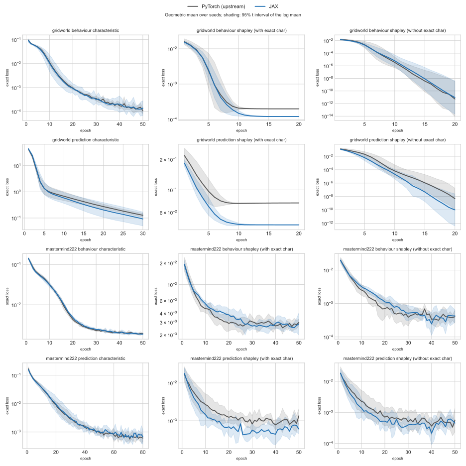

<details>
<summary>Deviations from upstream, and their effect</summary>

| Area | Upstream | Port | Effect |
| --- | --- | --- | --- |
| Random streams | torch and NumPy global generators | explicit JAX keys, split per run and per seed | Runs are not seed-for-seed identical; fixture tests replay recorded draws, and the end-to-end comparison is statistical |
| Precision | float64 value iteration; float32 networks | float32 throughout | Exact values agree within 1e-5 relative / 1e-4 absolute |
| Exact policy evaluation | value iteration to a 1e-10 change | direct linear solve of `(I − γ C_π) V = R_π` | Same fixed point |
| Non-terminating conditioned policy (γ = 1) | value iteration never terminates (the run hangs) | the run stops with an error naming the number of non-finite exact values, before any training | Only reachable with a policy that can loop forever, such as a weak greedy Gridworld agent; neither gives a result. The paper does not discuss it |
| Exact outcome states | `torch.unique` of the exact buffer | transition-model states, marked valid when present in the exact buffer | Same set of valid states |
| Null value `v(s, ∅)` | network on an all-masked batch | network on one all-masked row, broadcast | Identical values; avoids an XLA CPU miscompilation of broadcast-constant batches |
| Off-policy target after early stopping | best model restored; the target keeps its last weights | the target saved with the best model is restored too | The target is not used after training |
| Outcome optimiser | Adam over the model only | one Adam over model and target | The target's gradients are exactly zero, so Adam leaves it unchanged |
| On-policy terminal transitions | stores the reset observation as `n_obs` | stores the pre-reset observation | Masked by `(1 − terminated)`; equivalent |
| Truncated transitions | `final_observation` | Gymnax pre-reset observation | Same observation |
| Processes | one process per seed | every stage trains all its seeds in one compiled program | Each seed uses the keys of a single run with that seed |
| Checkpoints | model saves every tenth of the run | each stage's final state as one checkpoint artifact; stage-level resume | No numerical effect |
| Continual exact-buffer refresh | filled after acting, before the agent's update | filled before the step's DQN update | Same pre-update policy and epsilon |
| Sampled characteristic with no matching pool row | every score ties; `torch.topk`'s tie order picks a row of the freshly permuted pool | the pool row with the top uniform score | Both are one uniform pool row; matched rows select identically |

</details>

## Paper reproduction

The experiments marked rerun were run with this package and compared against targets extracted from upstream's own plot files, using criteria committed before any comparison: a curve matches at 25% and 100% of training when it is within a factor of 2 of the published mean or within 3 combined standard errors, a Hypercube bar within a factor of 1.5. **274 of 282 compared quantities match, and 16 of the paper's 26 claims hold** (the other 10: 7 need experiments not rerun, 3 fail, below). Figures of experiments not rerun show the published results only.

Quantities that miss:

- **Gridworld outcome (4):** the off-policy outcome characteristic ends 1.8–8× above the published loss, and the outcome Shapley values with the approximate behaviour characteristic 2.5–2.7× below. The claim that conditioning on the exact behaviour characteristic helps outcome estimates (Fig 1) fails narrowly.
- **Gridworld Shapley, final value (2):** with the approximate characteristic 3.3× below the published value, whose standard error excludes agent variance (every published run explains one characteristic of one agent); prediction with the exact characteristic at 1.3e-8 against 1.6e-6, both converged.
- **Mastermind-333 prediction characteristic at 25% of training (1):** a factor of 2.4; its final value matches.
- **Hypercube 2×4 behaviour Shapley (1):** 376 updates against 232, a factor of 1.6.
- **Claims:** unnormalised importance sampling is not worse than no reweighting in JAX (Fig 8, behaviour and prediction), every value within tolerance.

| Paper | What | Status | Comparison |
| --- | --- | --- | --- |
| Figs 1, 4 | Gridworld and Mastermind-222 behaviour, prediction and outcome explanations | rerun | 62 of 68 quantities match; misses below |
| Fig 4 | Mastermind-333 behaviour and prediction explanations | rerun | 11 of 12 match |
| Figs 2, 5 | Hypercube: updates to reach the target loss, by number of states | 31 of 40 cube × kind combinations rerun | 61 of 62 bars match |
| Figs 3a, 7–9 | off-policy characteristics: importance weighting and clipping | rerun | 58 of 58 match |
| Figs 3b, 10 | continual learning at update ratios 1, 2, 10 and 50 | rerun | 64 of 64 match |
| Figs 3c, 11 | sampled against learnt characteristics | Mastermind-222 behaviour and prediction rerun; its outcome panel, Gridworld and Mastermind-333 not rerun | 18 of 18 match |
| Tables 1–4, Fig 6 and appendix figures | large Mastermind (443, 453, 463) | not rerun | — |

JAX reruns are solid lines with standard-error bands, over the published curves, dashed. Rows scroll sideways.

### Figures 1 and 4: Gridworld, Mastermind-222 and Mastermind-333 explanations

**Main text (Mastermind-222)**

<table><tr>
<td align="center">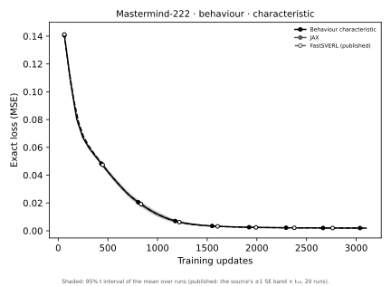<br><sub><code>main_mastermind_222_policy_char</code></sub></td>
<td align="center">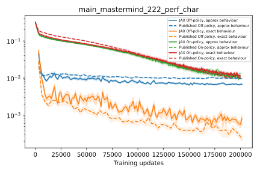<br><sub><code>main_mastermind_222_perf_char</code></sub></td>
<td align="center">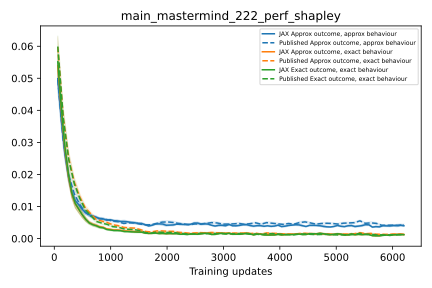<br><sub><code>main_mastermind_222_perf_shapley</code></sub></td>
</tr></table>

**Gridworld**

<table><tr>
<td align="center">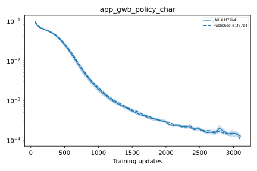<br><sub><code>app_gwb_policy_char</code></sub></td>
<td align="center">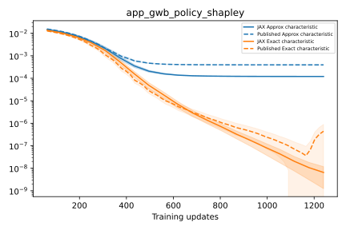<br><sub><code>app_gwb_policy_shapley</code></sub></td>
<td align="center">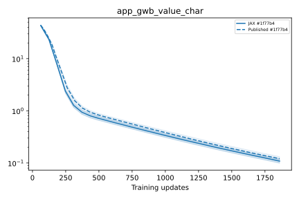<br><sub><code>app_gwb_value_char</code></sub></td>
<td align="center">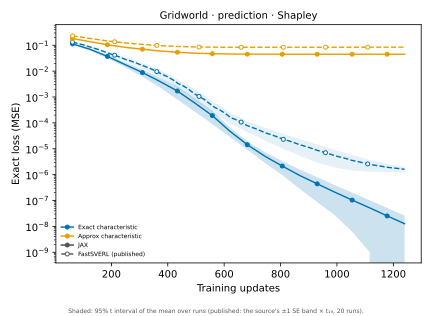<br><sub><code>app_gwb_value_shapley</code></sub></td>
<td align="center">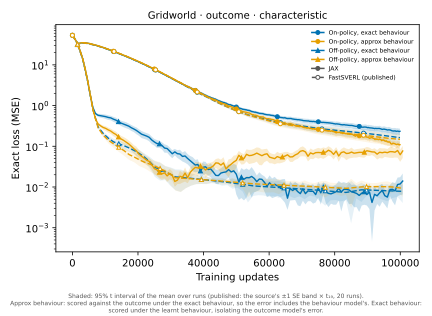<br><sub><code>app_gwb_perf_char</code></sub></td>
<td align="center">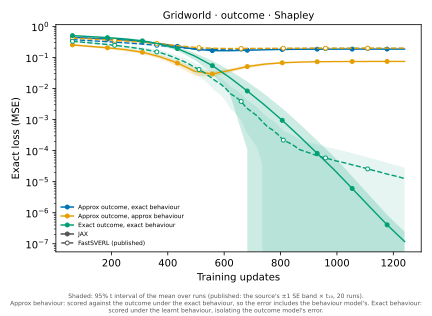<br><sub><code>app_gwb_perf_shapley</code></sub></td>
</tr></table>

**Mastermind-222**

<table><tr>
<td align="center">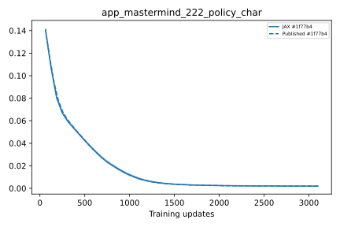<br><sub><code>app_mastermind_222_policy_char</code></sub></td>
<td align="center">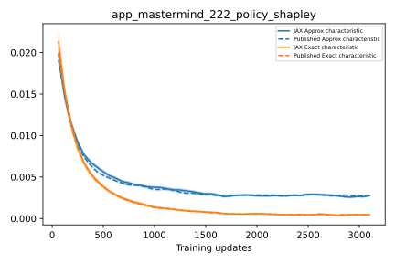<br><sub><code>app_mastermind_222_policy_shapley</code></sub></td>
<td align="center">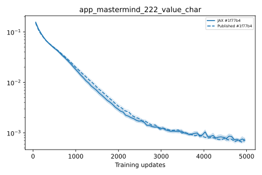<br><sub><code>app_mastermind_222_value_char</code></sub></td>
<td align="center">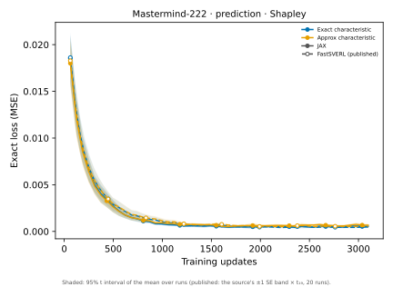<br><sub><code>app_mastermind_222_value_shapley</code></sub></td>
<td align="center">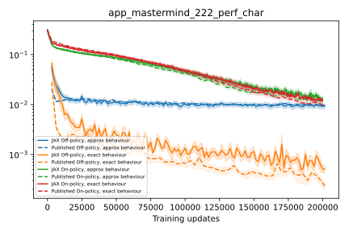<br><sub><code>app_mastermind_222_perf_char</code></sub></td>
<td align="center"><br><sub><code>app_mastermind_222_perf_shapley</code></sub></td>
</tr></table>

**Mastermind-333**

<table><tr>
<td align="center">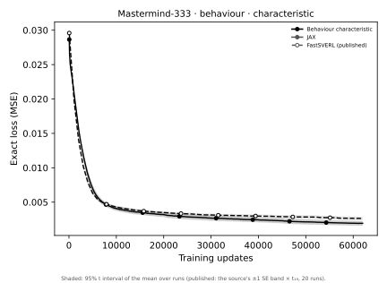<br><sub><code>app_mastermind_333_policy_char</code></sub></td>
<td align="center">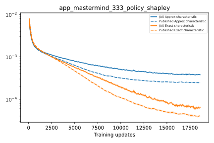<br><sub><code>app_mastermind_333_policy_shapley</code></sub></td>
<td align="center">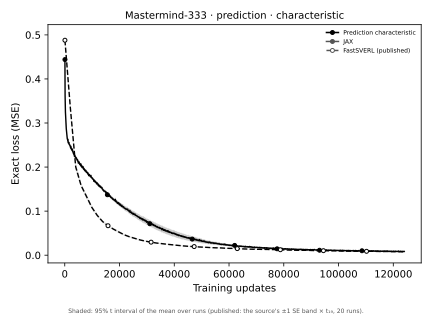<br><sub><code>app_mastermind_333_value_char</code></sub></td>
<td align="center">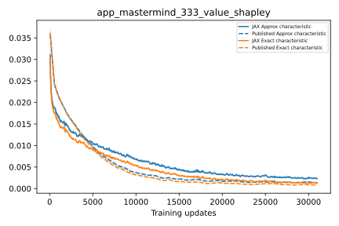<br><sub><code>app_mastermind_333_value_shapley</code></sub></td>
</tr></table>

### Figures 2 and 5: Hypercube scaling

<table><tr>
<td align="center">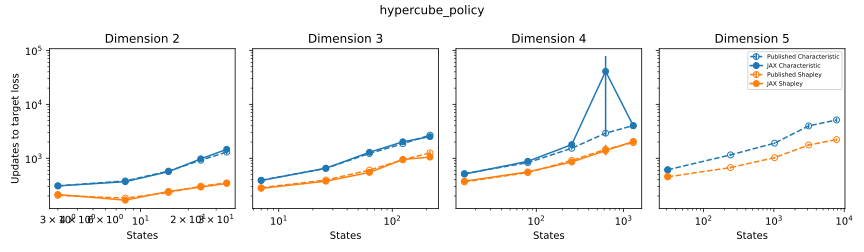<br><sub><code>hypercube_policy</code></sub></td>
<td align="center">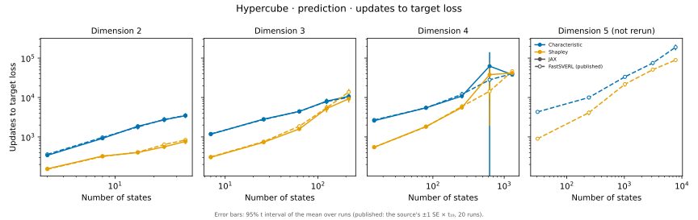<br><sub><code>hypercube_value</code></sub></td>
</tr></table>

### Figures 3a and 7–9: off-policy characteristics

**Main text (Mastermind-222)**

<table><tr>
<td align="center">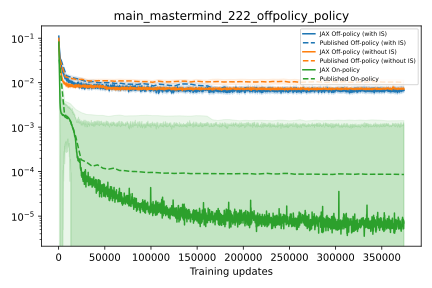<br><sub><code>main_mastermind_222_offpolicy_policy</code></sub></td>
</tr></table>

**Mastermind-222**

<table><tr>
<td align="center"><br><sub><code>app_mastermind_222_offpolicy_policy</code></sub></td>
<td align="center">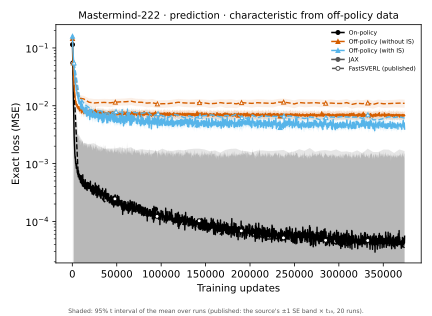<br><sub><code>app_mastermind_222_offpolicy_value</code></sub></td>
</tr></table>

**Gridworld**

<table><tr>
<td align="center">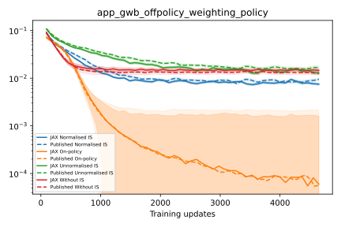<br><sub><code>app_gwb_offpolicy_weighting_policy</code></sub></td>
<td align="center">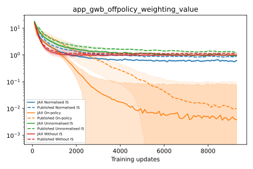<br><sub><code>app_gwb_offpolicy_weighting_value</code></sub></td>
<td align="center">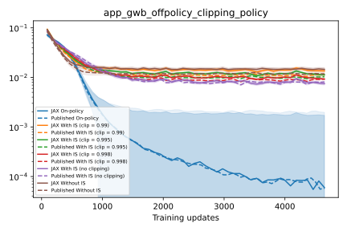<br><sub><code>app_gwb_offpolicy_clipping_policy</code></sub></td>
<td align="center">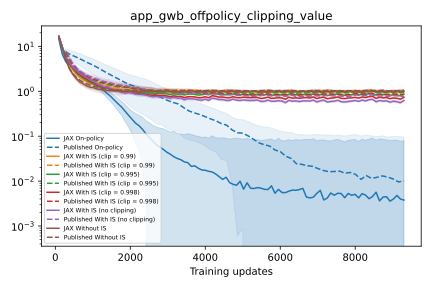<br><sub><code>app_gwb_offpolicy_clipping_value</code></sub></td>
</tr></table>

### Figures 3b and 10: continual learning

**Main text (Mastermind-222)**

<table><tr>
<td align="center">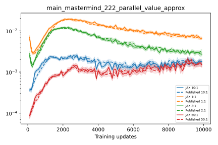<br><sub><code>main_mastermind_222_parallel_value_approx</code></sub></td>
</tr></table>

**Mastermind-222**

<table><tr>
<td align="center">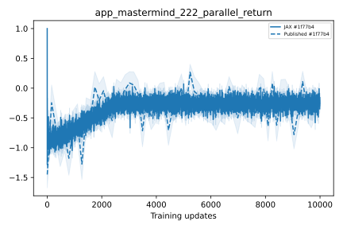<br><sub><code>app_mastermind_222_parallel_return</code></sub></td>
<td align="center">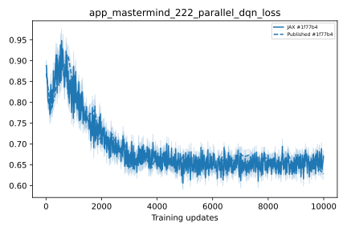<br><sub><code>app_mastermind_222_parallel_dqn_loss</code></sub></td>
<td align="center">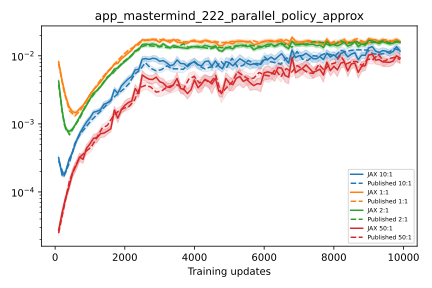<br><sub><code>app_mastermind_222_parallel_policy_approx</code></sub></td>
<td align="center">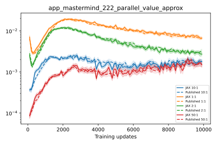<br><sub><code>app_mastermind_222_parallel_value_approx</code></sub></td>
<td align="center">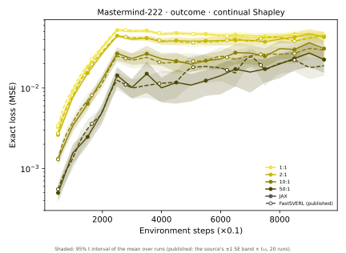<br><sub><code>app_mastermind_222_parallel_perf_approx_behaviour</code></sub></td>
</tr></table>

**Gridworld**

<table><tr>
<td align="center">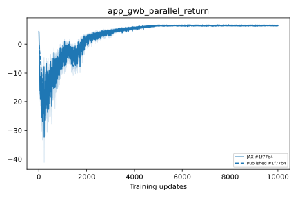<br><sub><code>app_gwb_parallel_return</code></sub></td>
<td align="center">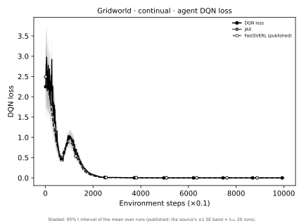<br><sub><code>app_gwb_parallel_dqn_loss</code></sub></td>
<td align="center">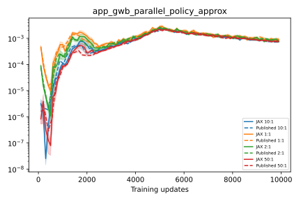<br><sub><code>app_gwb_parallel_policy_approx</code></sub></td>
<td align="center">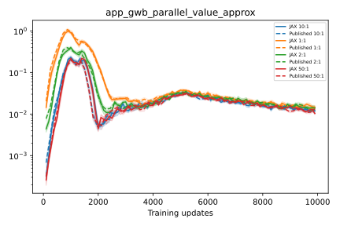<br><sub><code>app_gwb_parallel_value_approx</code></sub></td>
<td align="center">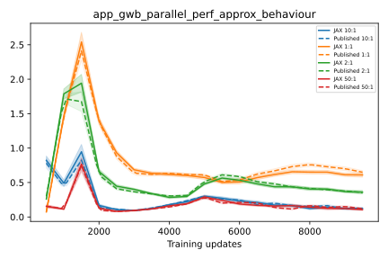<br><sub><code>app_gwb_parallel_perf_approx_behaviour</code></sub></td>
</tr></table>

### Figures 3c and 11: sampled characteristics

**Main text (Mastermind-222)**

<table><tr>
<td align="center">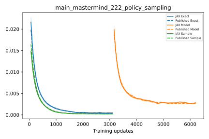<br><sub><code>main_mastermind_222_policy_sampling</code></sub></td>
</tr></table>

**Mastermind-222**

<table><tr>
<td align="center">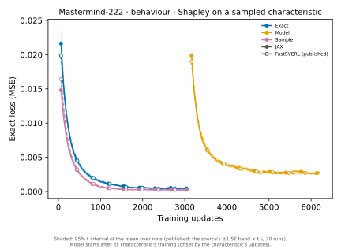<br><sub><code>app_mastermind_222_policy_sampling</code></sub></td>
<td align="center">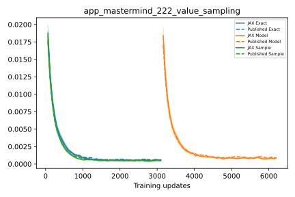<br><sub><code>app_mastermind_222_value_sampling</code></sub></td>
<td align="center">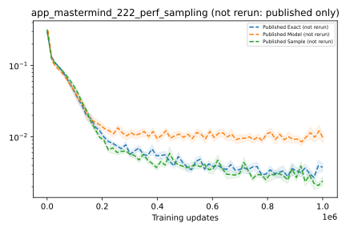<br><sub><code>app_mastermind_222_perf_sampling</code></sub></td>
</tr></table>

**Gridworld**

<table><tr>
<td align="center">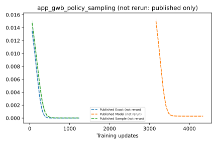<br><sub><code>app_gwb_policy_sampling</code></sub></td>
<td align="center">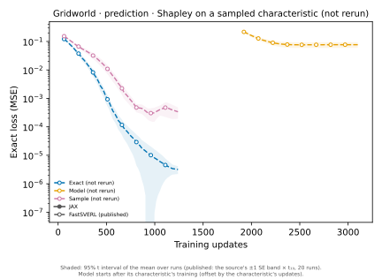<br><sub><code>app_gwb_value_sampling</code></sub></td>
<td align="center">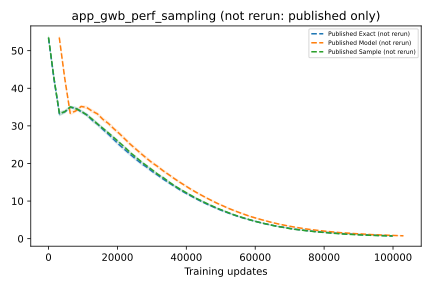<br><sub><code>app_gwb_perf_sampling</code></sub></td>
</tr></table>

**Mastermind-333**

<table><tr>
<td align="center">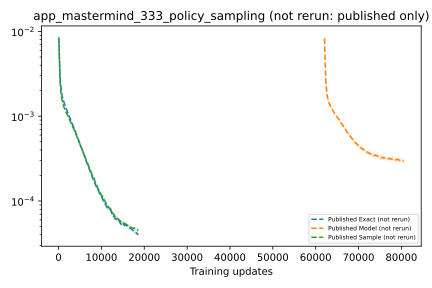<br><sub><code>app_mastermind_333_policy_sampling</code></sub></td>
<td align="center">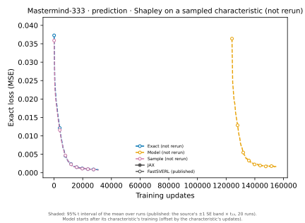<br><sub><code>app_mastermind_333_value_sampling</code></sub></td>
</tr></table>

### Large Mastermind: Fig 6 and appendix figures (not rerun)

<table><tr>
<td align="center">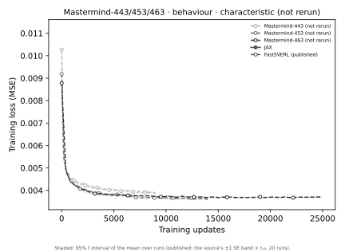<br><sub><code>app_large_policy_char</code></sub></td>
<td align="center">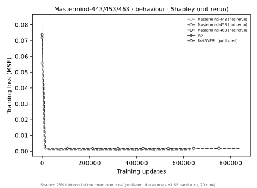<br><sub><code>app_large_policy_shapley</code></sub></td>
<td align="center">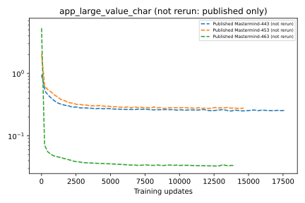<br><sub><code>app_large_value_char</code></sub></td>
<td align="center"><br><sub><code>app_large_value_shapley</code></sub></td>
<td align="center"><br><sub><code>app_large_perf_offpolicy_shapley</code></sub></td>
</tr></table>


## Install

```bash
uv sync --all-groups                 # CPU, including Apple Silicon
uv sync --all-groups --extra cuda    # NVIDIA CUDA 13
uv sync --all-groups --extra render  # environment rendering (Pillow)
```

For a TPU, install the TPU runtime for the locked JAX version into the project environment (`uv pip install --python .venv/bin/python "jax[tpu]==<version>"`), then set `UV_NO_SYNC=1` so `uv run` keeps it. Experiments track to [trackio](https://github.com/gradio-app/trackio) by default (local, no account) or to wandb (`uv run wandb login`).

## Running experiments

Every experiment is one config, `src/jax_shapley/configs/NAME.py`, run by `experiments/NAME.sh`:

```bash
bash experiments/mastermind222_behaviour.sh                        # tracked with trackio
bash experiments/mastermind222_behaviour.sh --track wandb --project my-project
bash experiments/hypercube_behaviour__sweep.sh --side-length 3 --dimension 4 -- --track wandb
bash experiments/smoke.sh mastermind222_behaviour                  # every stage, a few updates each
uv run python -m jax_shapley.main mastermind222_behaviour --shapley.1.train.epochs 9
```

- **Compile first.** Every script runs `--compile-only` before it trains: each stage is traced, lowered and compiled at the configured shapes, and nothing runs or is tracked. A compilation failure stops the run; there is no eager fallback.
- **Sweeps** are `configs/NAME__sweep.py`. They leave their swept fields `MISSING`, which `experiments/NAME__sweep.sh` supplies for each sweep point; each point is its own run group.
- **Overrides.** Any config field can be overridden on the command line, for example `--algorithm.total-timesteps`, `--characteristic.train.epochs` or `--shapley.0.seeds 1 2 3`.
- **Runs and artifacts.** Each stage logs its runs as `NAME--STAGE--VARIANT--seed-N` (for example `NAME--shapley--behaviour--with-exact--seed-1`) in one run group, `NAME-TIMESTAMP`, under upstream's metric names, and pushes its whole final state as a checkpoint artifact, `GROUP--STAGE--VARIANT`. Uploads retry transient tracking-service failures.
- **Resume.** A stage given a checkpoint loads it instead of training, for example `--algorithm.checkpoint GROUP--algorithm--dqn:latest`; it must have been saved with the same settings. An interrupted stage reruns.
- **Accelerators.** On a GPU or TPU, keep the CPU platform available for the logging callbacks: `JAX_PLATFORMS=cuda,cpu` or `JAX_PLATFORMS=tpu,cpu`.
- **Paper figures and tables** are regenerated from the tracking backend: `uv run --group benchmark python scripts/paper/figures.py --track wandb --project my-project`, then `scripts/paper/tables.py` and `scripts/paper/compare.py`.

<details>
<summary>Experiment settings (the upstream drivers' values)</summary>

| Run | Epochs | Patience | Other |
| --- | --- | --- | --- |
| Gridworld behaviour characteristic | 50 | = epochs | |
| Gridworld prediction characteristic | 30 | = epochs | |
| Gridworld Shapley | 20 | = epochs | |
| Mastermind-222 behaviour characteristic | 50 | 10,000 | |
| Mastermind-222 prediction characteristic | 80 | 10,000 | |
| Mastermind-222 Shapley | 50 | 10,000 | |
| Hypercube (all stages) | 10,000 | = epochs | validation fraction 0.016 (160 rows), exact buffer 100,000, exact condition 0.01 (characteristic) and 0.001 (behaviour Shapley) or 0.01 (prediction Shapley), Shapley without the exact characteristic, `track_batch` |
| Gridworld outcome, off-policy | 128 | = epochs | replay prefix 50,000, validation 80, batch 64, τ 0.001, `track_batch` |
| Gridworld outcome, on-policy | — | — | 100,000 steps over 8 environments, batch 64, τ 0.001 |
| Gridworld outcome Shapley | 20 | = epochs | |
| Mastermind-222 outcome, off-policy | 128 | = epochs | replay prefix 100,000, validation 160, batch 64, τ 0.01, `track_batch` |
| Mastermind-222 outcome, on-policy | — | — | 200,000 steps over 16 environments, batch 64, τ 0.01 |
| Mastermind-222 outcome Shapley | 100 | = epochs | |

Unless stated otherwise: learning rate 2.5e-4, batch 128, a 10,000-observation buffer split 80/20 into train and validation, 16 collection environments, the greedy explained policy, 2×64 ReLU networks (2×128 for Hypercube and larger Mastermind) and γ = 1. DQN agents: 50,000 transitions on Gridworld and 100,000 over 16 environments on Mastermind-222, with exploration fractions 0.5 and 0.25.

</details>

## Code layout

An experiment is a pipeline of stages, **agent → characteristic → [outcome] → Shapley**, or an agent and its explanations trained together (continual learning).

| Module | Contents |
| --- | --- |
| `envs/` | Gridworld, Hypercube and Mastermind as Gymnax environments; the episode-statistics wrapper; rendering |
| `algorithms/dqn.py` | DQN: config, state, one vector step, training, evaluation, the agent stage |
| `algorithms/ppo.py` | PPO actor and critic networks (PPO training is not ported: the paper reports DQN agents only) |
| `characteristic_models/` | `behaviour.py` (the shared characteristic stage and the policy target), `prediction.py` (the value target), `outcome.py` (off- and on-policy outcome characteristics, exact outcome values) |
| `shapley_models/` | `behaviour.py` (the shared Shapley stage), `prediction.py`, `outcome.py` |
| `common/` | networks; coalitions and masking; the shared epoch loop; buffer collection; tabular models and exact policy evaluation; checkpoints |
| `experiment.py`, `main.py`, `continual.py` | experiment configs, the pipeline, and continual learning |
| `configs/` | one config per paper experiment |

## Using the components

The environments follow the Gymnax API, and `step` auto-resets finished episodes:

```python
import jax
from jax_shapley.envs import Hypercube
from jax_shapley.envs.wrappers import EpisodeStatisticsWrapper

env = EpisodeStatisticsWrapper(Hypercube(side_length=6, dimension=5))
params = env.default_params
obs, state = env.reset(jax.random.key(0), params)
obs, state, reward, done, info = env.step(jax.random.key(1), state, action=0, params=params)

batched_step = jax.jit(jax.vmap(env.step, in_axes=(0, 0, 0, None)))  # run inside jax.lax.scan
```

`env.env.step_env()` gives the raw transition before auto-reset. Gridworld keeps FastSVERL's `[0, 0]` terminal observation; Hypercube supports side lengths 2–6 and dimensions 2–5; Mastermind takes any code size, number of guesses and pegs. Observations, actions and counters are int32, rewards float32, flags bool.

Rendering is a host-side call outside `jit`, after `uv sync --extra render`:

```python
from jax_shapley.envs import Gridworld, RenderConfig

env = Gridworld()
_, state = env.reset(jax.random.key(0), env.default_params)
frame = env.render(state, env.default_params, RenderConfig(width=640, height=480))  # uint8 RGB
```

  

A DQN agent's Q-network:

```python
import jax.numpy as jnp
from jax_shapley.algorithms import dqn
from jax_shapley.envs import Mastermind

config = dqn.DQNConfig(env=Mastermind(2, 2, 2), hidden_widths=(64, 64))
network = dqn.initialize(config, jax.random.key(0)).model
q_values = network(jnp.full((16, 8), -1, dtype=jnp.int32)).q_values
```

Networks use PyTorch's default Linear initialisation, or FastSVERL's orthogonal override where a layer selects it; JAX and PyTorch seeds do not produce identical weights.

## Development

`AGENTS.md` defines the coding and validation conventions. Every change passes the gates:

```bash
./check.sh   # ty check, ruff check, ruff format --check, pytest
```

Tests are offline and independent of PyTorch. Compile tests trace, lower and compile every stage and every registered experiment; fixture tests check numerical units against upstream; GPU tests skip when no GPU is available. The fixtures are captured from the pinned FastSVERL checkout in a separate PyTorch environment, for example:

```bash
uv run --script scripts/fixtures/collect_fastsverl_explanations.py /path/to/fastsverl tests/fixtures/fastsverl_explanations.npz
```

The other collectors in `scripts/fixtures/` (transitions, networks, DQN, logging, outcome, pipeline, sampling) follow the same pattern.
