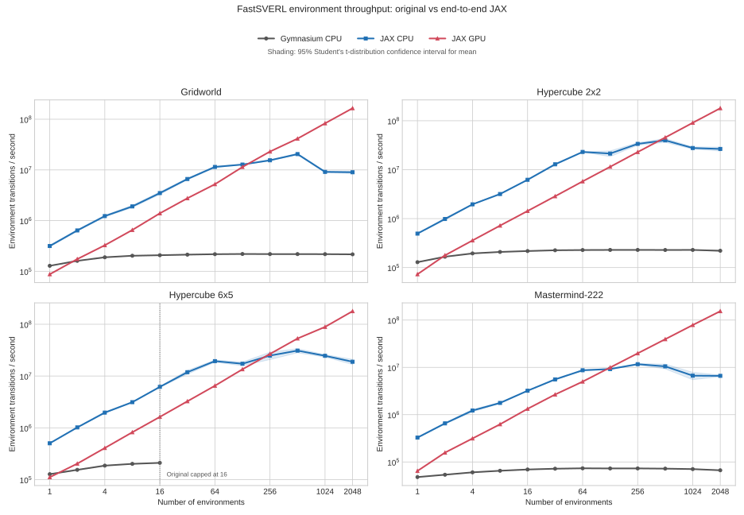

# jax-shapley

End-to-end JAX/Gymnax ports of the reinforcement-learning environments used by [FastSVERL](https://github.com/djeb20/fastsverl): Gridworld, all 20 obstacle-free paper Hypercubes, and Mastermind-222.

## Install

```bash
uv sync --all-groups                 # portable CPU
uv sync --all-groups --extra cuda    # NVIDIA CUDA 13
```

## Use

```python
import jax
from PIL import Image
from jax_shapley import EpisodeStatisticsWrapper
from jax_shapley.envs import Gridworld, Hypercube, Mastermind222

env = EpisodeStatisticsWrapper(Hypercube(side_length=6, dimension=5))
params = env.default_params
obs, state = env.reset(jax.random.key(0), params)
obs, state, reward, done, info = env.step(jax.random.key(1), state, action=0, params=params)
```

The environments use the Gymnax API. Public `step()` auto-resets terminal instances; `env.env.step_env()` accesses raw FastSVERL-compatible transitions on the unwrapped environment. Gridworld preserves the FastSVERL `[0, 0]` terminal-observation quirk. Hypercube supports side lengths 2–6 and dimensions 2–5 as static JAX specializations. Mastermind-222 preserves the source action decoding, eight-feature board, clues, rewards, and horizon.

Exhaustive environment cards:

- [Gridworld](src/jax_shapley/envs/gridworld.md)
- [Hypercube](src/jax_shapley/envs/hypercube.md)
- [Mastermind-222](src/jax_shapley/envs/mastermind.md)

Vectorization uses the standard JAX composition:

```python
batched_reset = jax.jit(jax.vmap(env.reset, in_axes=(0, None)))
batched_step = jax.jit(jax.vmap(env.step, in_axes=(0, 0, 0, None)))
# Place batched_step in jax.lax.scan for a fully compiled rollout.
```

`EpisodeStatisticsWrapper` accumulates per-environment return, length, and completed-episode count. Each step adds fixed-shape `info["episode"]` return, length, and completion fields; `vmap` and `lax.scan` turn them into a masked episode-event stream.

## Rendering

Install the optional renderer interface with `uv sync --extra render`. Rendering is an explicit host-side operation outside `jit`, `vmap`, and `lax.scan`:

```python
import jax
from PIL import Image
from jax_shapley.envs import Gridworld, RenderConfig

env = Gridworld()
params = env.default_params
_, state = env.reset(jax.random.key(0), params)
frame = env.render(state, params, RenderConfig(width=640, height=480))

assert frame.shape == (480, 640, 3)
assert frame.dtype.name == "uint8"
```

The public array remains RGB. The committed documentation WebPs use the same renderer with an internal alpha-aware export path so their outer canvas is transparent while boards, legends, and status panels remain opaque and readable.

Call `render()` after each already-compiled step to capture an episode, or retain selected states from a compiled rollout and render them afterwards. For an `EpisodeStatisticsWrapper` state, render with `wrapped_env.env.render(state.env_state)`.

See the [environment rendering guide](docs/Environment%20Rendering.md) for rendering contracts, higher-dimensional Hypercube projections, and the Mastermind secret policy.

## Validation

Offline fixtures were exhaustively captured from FastSVERL commit `25b2cbe66b0d4a0decc3b63dbc798a79bf2c7d5b`; normal tests never download, install, or import FastSVERL.

```bash
JAX_PLATFORMS=cpu uv run pytest
JAX_PLATFORMS=cuda uv run --extra cuda pytest tests/test_env_transition_parity.py -m gpu
uv run ruff check .
```

GPU-specific commands log that they were skipped and exit successfully when no JAX GPU backend is available.

CPU and GPU each match all **143,136** source transitions with zero differences. See the [environment port report](docs/Quantitative%20Comparison%20between%20Gymnasium%20and%20JAX%20environment%20implementations%20of%20FastSVERL.md) for raw CPU/GPU throughput, speedups, methodology, and reproduction commands.



## Agent networks

Typed Flax NNX networks provide DQN Q-values and independent PPO actor probabilities and critic values. Inputs have a final feature axis with optional leading batch/rollout axes. The model boundary converts int32 observations to float32; parameters and outputs use float32.

```python
import jax.numpy as jnp
from flax import nnx
from jax_shapley import QNetwork, dqn_config

network = QNetwork(dqn_config(input_features=8, num_actions=4), rngs=nnx.Rngs(0))
observations = jnp.full((16, 8), -1, dtype=jnp.int32)
q_values = nnx.jit(lambda model, obs: model(obs).q_values)(network, observations)
```

The default DQN hidden widths are `(64, 64)` for Gridworld and Mastermind-222. Pass `hidden_widths=(128, 128)` for the upstream Hypercube/larger-Mastermind architectures. PPO architectures are explicit `MLPConfig` values; upstream does not supply paper-specific PPO presets. Initialization follows PyTorch Linear's uniform kernel/bias distribution unless a layer explicitly selects FastSVERL's orthogonal override. JAX and PyTorch seeds do not generate identical weights.

Offline matched-weight tests compare outputs and input/parameter gradients against the pinned source builder, in eager and compiled execution. Abstract NNX compilation tests cover single observations, batches, rollout axes, int32/float32 inputs, gradients, `vmap`, and `scan`; GPU coverage skips explicitly when unavailable.

See the [network port guide](docs/Agent%20Networks.md) for configurations, output contracts, and fixture reproduction. DQN training, replay, typed CLI settings, and shell recipes are implemented; see the [DQN training guide](docs/DQN%20Training.md). PPO training, FastSVERL explanation models, and paper evaluation reproduction remain deferred.

## Typed contracts and compile-first checks

[AGENTS.md](AGENTS.md) defines the project coding and validation conventions.
Environment observations, actions, and counters use `int32`; rewards and discounts
use `float32`; termination flags use `bool`. `jaxtyping` annotations describe shape
and dtype intent without adding runtime checking or proving dimensions under ty.
`StepInfo` and `EpisodeStepInfo` expose the transition and episode metadata schemas.

The wrapper explicitly exposes reset, step, spaces, name, and action count. Access
other environment capabilities through `wrapped_env.env`; arbitrary attribute
forwarding is no longer part of the wrapper interface.

Compile tests trace abstract shape/dtype inputs, lower and compile representative
environment specializations and batched rollouts, and check output contracts.
Rendering remains a host-side operation.


Run these gates before opening PRs or long experiments:

```bash
uv run ty check
uv run ruff check .
uv run ruff format --check .
uv run pytest
```

Quick alias:

```bash
./check.sh
```

## DQN experiments

Experiment settings live in shell recipes, parsed by Tyro into validated Python dataclasses. The experiment flow, configuration and learning code live together in [train_dqn.py](src/jax_shapley/train_dqn.py); [replay.py](src/jax_shapley/replay.py) defines the buffer; [networks.py](src/jax_shapley/networks.py) defines the models and [run_io.py](src/jax_shapley/run_io.py) handles callbacks, CSV and Orbax recovery.

```bash
bash experiments/dqn/gridworld.sh --validate-only
bash experiments/dqn/mastermind222.sh --compile-only
bash experiments/dqn/smoke.sh --output /tmp/jax-shapley-smoke
```

Normal recipes run the required gates, compile initialization/training/evaluation into one numerical invocation, and save selective CSV metrics plus Orbax checkpoints. Full-state checkpoints are the default; resume with `uv run python -m jax_shapley.train_dqn resume --run runs/<run-name>`. See the [DQN training guide](docs/DQN%20Training.md) for upstream settings, overrides, artifact loading, and device validation.
