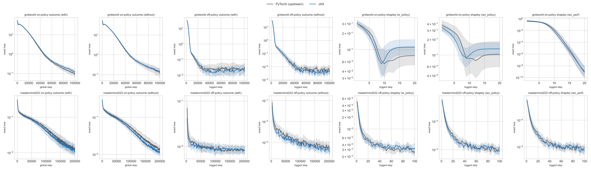

# Quantitative Comparison between PyTorch and JAX explanations of FastSVERL

This report compares the JAX behaviour, prediction and outcome explanations with the unchanged PyTorch FastSVERL code at commit `25b2cbe66b0d4a0decc3b63dbc798a79bf2c7d5b`. Both sides train the whole pipeline from scratch with the paper's settings, 20 seeds per configuration. The two implementations use independent random streams, so their agents, buffers and coalitions differ, and the comparison is distributional rather than seed for seed. Deterministic parity of every numerical unit, given identical inputs, is established separately by the fixture tests in the [explanations guide](Explanations.md).

## Summary

- **Pre-registered equivalence test: 32 of 60 comparisons pass.** The test, its margins and the margin rule were committed before any upstream result existed (commit `f961aef`). The test has low power: a simulation shows that two identical implementations fail it about 34% of the time at 20 vs 20 seeds (see [Power](#power-of-the-pre-registered-test)), so roughly 20 failures are expected by chance alone.
- **Failure breakdown:**
  - 20 are inconclusive: the 90% interval of the JAX/upstream ratio contains 1 but is wider than the margin.
  - 3 are the known paper-protocol confound (below); their matched-protocol counterparts pass.
  - 5 have intervals excluding 1:
    - two characteristic rows differ by 2.5% and 5.6% (p ≈ 0.07)
    - the two Mastermind behaviour Shapley rows without the exact characteristic are 1.3× (p = 0.03 and 0.045); both protocols explain the same single agent per framework
    - Hypercube 3×2 behaviour Shapley stopping (0.80×, p = 0.002) was investigated: it comes from the DQN agents, not the explanation code (see [Hypercube 3×2](#hypercube-32-shapley-stopping))
  - No difference survives a correction for 60 comparisons.
- **Outcome explanations** (new in this run) show no systematic difference. Every outcome comparison's interval contains 1.
- **Speed (CPU):** per seed and epoch, JAX trains **5.4–10× faster** for every stage. End-to-end wall time, including start-up and compilation, is **4–12× faster** for Gridworld and Mastermind, where each stage trains all 20 seeds in one compiled program. Hypercube is **2.2–2.5× faster**, because each seed's agent still trains in its own process.

## Setup

| Item | Value |
| --- | --- |
| Machine | Apple M4 Pro, 14 CPU cores, 48 GB, macOS 27.0.1; CPU only |
| JAX side | jax 0.11.0, flax 0.12.8, optax 0.2.8, `JAX_PLATFORMS=cpu` |
| PyTorch side | torch 2.6.0, gymnasium 0.29.1, numpy < 2, Python 3.12, pinned FastSVERL checkout installed in editable mode |
| Seeds | 20 per configuration, as in the paper |
| Execution | Sequential on an otherwise idle machine; JAX trains each stage's 20 seeds as one sweep |

**Protocols.**

- **Gridworld and Mastermind-222 (paper protocol):** one DQN agent (seed 1); characteristic seeds 1–20; Shapley seeds 1–20 all explaining the *first* characteristic, each with and without the exact characteristic as ground truth.
- **Matched protocol (`<domain>-matched`):** identical, except Shapley seed *s* explains characteristic seed *s*, so seeds are independent replicates of both stages.
- **Outcome (`<domain>-outcome`, matched replicates):** seed *s* trains its own agent, behaviour characteristic, outcome characteristics (on- and off-policy, each with and without the exact behaviour characteristic) and outcome Shapley models. The Shapley models explain the variant upstream's driver uses (on-policy for Gridworld, off-policy for Mastermind) in the driver's three groups:
  - `w_policy`: exact outcome values conditioned on the exact behaviour characteristic
  - `wo_policy`: exact outcome values conditioned on the learnt behaviour characteristic
  - `wo_perf`: the learnt outcome characteristic as ground truth
- **Hypercube:** cubes 3×2, 3×3 and 2×5, both kinds; each seed trains its own agent, characteristic and Shapley model, stopping at the paper's exact-loss conditions.

All settings are the upstream drivers' dataclass defaults plus their per-domain values, encoded on the JAX side in `experiments/explanations/`.

**Upstream harness.** Each upstream run script executes unchanged in its own process. Five things differ from upstream's own drivers:

- `import fastsverl.envs` runs first. The committed run scripts never import it, so gym cannot find the registered environments without it.
- Weights & Biases tracking is off.
- `save_explanations` is off.
- Outcome runs time out after an hour, because a conditioned policy that can loop forever makes upstream value iteration never terminate. No run hit the limit.
- Metrics are read back from upstream's TensorBoard logs.

## Statistical method

The metric is log10 of each run's final exact loss, and for Hypercube also of the batches until the exact-loss stopping condition.

1. **Margins first, from JAX alone.** For each metric, the margin is the 95th percentile of the absolute difference between the mean log10 values of two random halves (10 vs 10) of the JAX seeds, with a floor of log10(1.02). This is the difference two halves of one implementation show by chance. The margins were computed with `compare.py --mode margins` and committed (`docs/data/explanations-port--margins.csv`, commit `f961aef`) before the upstream side ran.
2. **Equivalence (TOST, α = 0.05).** A comparison passes when the 90% Welch interval of the JAX-minus-upstream mean log10 difference lies inside ±margin.
3. Welch difference p-values are kept for reference.

### Power of the pre-registered test

The margin turned out to be about as wide as the interval it must contain. Simulating two identical normal implementations with 20 seeds each, deriving the margin from one of them exactly as above, the test fails **34%** of the time. A pass is therefore strong evidence of equivalence; a failure with an interval containing 1 is not evidence of a difference. This should have been checked before committing the margin rule. It is reported here unchanged, rather than replaced after seeing the data.

## Fidelity

Values are geometric means over seeds. "Ratio" is JAX ÷ upstream with its 90% interval; "Margin" is the pre-registered equivalence bound on that ratio. "Group" is the exact-loss ground truth (`with`/`without` the exact characteristic) or the outcome Shapley group.

| Environment | Kind | Stage | Group | Metric | Upstream | JAX | Ratio (90% CI) | Margin | Result |
| --- | --- | --- | --- | --- | --- | --- | --- | --- | --- |
| gridworld | behaviour | characteristic | — | final exact loss | 0.000103 | 0.000115 | 1.11 (0.93–1.34) | ×1.44 | equivalent |
| gridworld | behaviour | shapley | with | final exact loss | 0.000199 | 0.00012 | 0.61 (0.61–0.61) | ×1.02 | **not equivalent** (paper-protocol confound) |
| gridworld | behaviour | shapley | without | final exact loss | 1.03e-11 | 1.5e-11 | 1.46 (0.08–25.81) | ×128.05 | equivalent |
| gridworld | prediction | characteristic | — | final exact loss | 0.117 | 0.102 | 0.87 (0.71–1.06) | ×1.37 | inconclusive |
| gridworld | prediction | shapley | with | final exact loss | 0.0743 | 0.0451 | 0.61 (0.61–0.61) | ×1.02 | **not equivalent** (paper-protocol confound) |
| gridworld | prediction | shapley | without | final exact loss | 8.21e-10 | 1.19e-10 | 0.15 (0.02–1.22) | ×29.27 | inconclusive |
| gridworld-matched | behaviour | shapley | with | final exact loss | 0.000206 | 0.000179 | 0.87 (0.57–1.33) | ×2.00 | equivalent |
| gridworld-matched | behaviour | shapley | without | final exact loss | 1.29e-11 | 1.86e-11 | 1.44 (0.08–24.60) | ×104.31 | equivalent |
| gridworld-matched | prediction | shapley | with | final exact loss | 0.0755 | 0.0696 | 0.92 (0.76–1.12) | ×1.34 | equivalent |
| gridworld-matched | prediction | shapley | without | final exact loss | 3.38e-10 | 2.35e-09 | 6.94 (0.91–53.13) | ×17.30 | inconclusive |
| gridworld-outcome | behaviour | characteristic | — | final exact loss | 0.000103 | 0.000115 | 1.11 (0.93–1.34) | ×1.44 | equivalent |
| gridworld-outcome | off_policy | outcome | with | final exact loss | 0.0236 | 0.0206 | 0.87 (0.39–1.94) | ×3.47 | equivalent |
| gridworld-outcome | off_policy | outcome | without | final exact loss | 0.00537 | 0.00402 | 0.75 (0.38–1.48) | ×2.63 | inconclusive |
| gridworld-outcome | on_policy | outcome | with | final exact loss | 0.0865 | 0.121 | 1.40 (0.96–2.05) | ×1.70 | inconclusive |
| gridworld-outcome | on_policy | outcome | without | final exact loss | 0.119 | 0.146 | 1.22 (0.75–1.99) | ×1.61 | inconclusive |
| gridworld-outcome | on_policy | shapley | w_policy | final exact loss | 0.0775 | 0.111 | 1.43 (0.95–2.16) | ×1.83 | inconclusive |
| gridworld-outcome | on_policy | shapley | wo_perf | final exact loss | 7.73e-10 | 1.05e-09 | 1.36 (0.12–15.41) | ×47.60 | equivalent |
| gridworld-outcome | on_policy | shapley | wo_policy | final exact loss | 0.104 | 0.132 | 1.27 (0.76–2.12) | ×1.69 | inconclusive |
| hypercube-2x5 | behaviour | characteristic | — | batches to stop | 608 | 608 | 1.00 (1.00–1.00) | ×1.02 | equivalent |
| hypercube-2x5 | behaviour | characteristic | — | final exact loss | 0.00816 | 0.00813 | 1.00 (0.94–1.05) | ×1.10 | equivalent |
| hypercube-2x5 | behaviour | shapley | without | batches to stop | 446 | 458 | 1.03 (0.97–1.09) | ×1.09 | equivalent |
| hypercube-2x5 | behaviour | shapley | without | final exact loss | 0.000749 | 0.000785 | 1.05 (0.97–1.13) | ×1.12 | inconclusive |
| hypercube-2x5 | prediction | characteristic | — | batches to stop | 4.24e+03 | 4.25e+03 | 1.00 (0.97–1.04) | ×1.06 | equivalent |
| hypercube-2x5 | prediction | characteristic | — | final exact loss | 0.00918 | 0.00919 | 1.00 (0.97–1.04) | ×1.06 | equivalent |
| hypercube-2x5 | prediction | shapley | without | batches to stop | 936 | 936 | 1.00 (0.95–1.06) | ×1.07 | equivalent |
| hypercube-2x5 | prediction | shapley | without | final exact loss | 0.00773 | 0.00769 | 0.99 (0.91–1.08) | ×1.16 | equivalent |
| hypercube-3x2 | behaviour | characteristic | — | batches to stop | 389 | 367 | 0.94 (0.90–0.99) | ×1.07 | **not equivalent** (interval excludes 1) |
| hypercube-3x2 | behaviour | characteristic | — | final exact loss | 0.00674 | 0.00683 | 1.01 (0.91–1.12) | ×1.19 | equivalent |
| hypercube-3x2 | behaviour | shapley | without | batches to stop | 207 | 165 | 0.80 (0.71–0.89) | ×1.18 | **not equivalent** (interval excludes 1) |
| hypercube-3x2 | behaviour | shapley | without | final exact loss | 0.000199 | 0.000253 | 1.27 (0.57–2.84) | ×3.62 | equivalent |
| hypercube-3x2 | prediction | characteristic | — | batches to stop | 939 | 918 | 0.98 (0.91–1.05) | ×1.05 | inconclusive |
| hypercube-3x2 | prediction | characteristic | — | final exact loss | 0.00783 | 0.00804 | 1.03 (0.94–1.12) | ×1.14 | equivalent |
| hypercube-3x2 | prediction | shapley | without | batches to stop | 310 | 325 | 1.05 (0.99–1.11) | ×1.09 | inconclusive |
| hypercube-3x2 | prediction | shapley | without | final exact loss | 0.00291 | 0.00246 | 0.85 (0.57–1.25) | ×2.11 | equivalent |
| hypercube-3x3 | behaviour | characteristic | — | batches to stop | 612 | 648 | 1.06 (0.99–1.13) | ×1.12 | inconclusive |
| hypercube-3x3 | behaviour | characteristic | — | final exact loss | 0.00857 | 0.00838 | 0.98 (0.93–1.03) | ×1.09 | equivalent |
| hypercube-3x3 | behaviour | shapley | without | batches to stop | 365 | 373 | 1.02 (0.95–1.10) | ×1.11 | equivalent |
| hypercube-3x3 | behaviour | shapley | without | final exact loss | 0.000735 | 0.000716 | 0.97 (0.89–1.07) | ×1.15 | equivalent |
| hypercube-3x3 | prediction | characteristic | — | batches to stop | 2.68e+03 | 2.79e+03 | 1.04 (0.94–1.15) | ×1.18 | equivalent |
| hypercube-3x3 | prediction | characteristic | — | final exact loss | 0.00868 | 0.00904 | 1.04 (1.00–1.09) | ×1.06 | inconclusive |
| hypercube-3x3 | prediction | shapley | without | batches to stop | 757 | 727 | 0.96 (0.89–1.03) | ×1.12 | inconclusive |
| hypercube-3x3 | prediction | shapley | without | final exact loss | 0.00771 | 0.00709 | 0.92 (0.81–1.05) | ×1.24 | equivalent |
| mastermind222 | behaviour | characteristic | — | final exact loss | 0.00196 | 0.00191 | 0.97 (0.95–1.00) | ×1.03 | **not equivalent** (interval excludes 1) |
| mastermind222 | behaviour | shapley | with | final exact loss | 0.00273 | 0.00272 | 1.00 (0.92–1.09) | ×1.18 | equivalent |
| mastermind222 | behaviour | shapley | without | final exact loss | 0.000329 | 0.000433 | 1.32 (1.07–1.62) | ×1.37 | **not equivalent** (interval excludes 1) |
| mastermind222 | prediction | characteristic | — | final exact loss | 0.000729 | 0.000676 | 0.93 (0.76–1.13) | ×1.37 | equivalent |
| mastermind222 | prediction | shapley | with | final exact loss | 0.00114 | 0.00062 | 0.54 (0.44–0.66) | ×1.44 | **not equivalent** (paper-protocol confound) |
| mastermind222 | prediction | shapley | without | final exact loss | 0.000521 | 0.000506 | 0.97 (0.77–1.23) | ×1.43 | equivalent |
| mastermind222-matched | behaviour | shapley | with | final exact loss | 0.00266 | 0.00278 | 1.04 (0.95–1.14) | ×1.18 | equivalent |
| mastermind222-matched | behaviour | shapley | without | final exact loss | 0.000336 | 0.000431 | 1.29 (1.05–1.58) | ×1.39 | **not equivalent** (interval excludes 1) |
| mastermind222-matched | prediction | shapley | with | final exact loss | 0.000809 | 0.000778 | 0.96 (0.72–1.29) | ×1.56 | equivalent |
| mastermind222-matched | prediction | shapley | without | final exact loss | 0.000465 | 0.000548 | 1.18 (0.92–1.50) | ×1.48 | inconclusive |
| mastermind222-outcome | behaviour | characteristic | — | final exact loss | 0.00203 | 0.00197 | 0.97 (0.93–1.01) | ×1.07 | inconclusive |
| mastermind222-outcome | off_policy | outcome | with | final exact loss | 0.00825 | 0.00838 | 1.02 (0.82–1.26) | ×1.50 | equivalent |
| mastermind222-outcome | off_policy | outcome | without | final exact loss | 0.000478 | 0.00035 | 0.73 (0.43–1.24) | ×2.25 | inconclusive |
| mastermind222-outcome | off_policy | shapley | w_policy | final exact loss | 0.00263 | 0.00308 | 1.17 (0.88–1.56) | ×1.74 | equivalent |
| mastermind222-outcome | off_policy | shapley | wo_perf | final exact loss | 0.000753 | 0.000903 | 1.20 (0.88–1.64) | ×1.57 | inconclusive |
| mastermind222-outcome | off_policy | shapley | wo_policy | final exact loss | 0.00093 | 0.00115 | 1.24 (0.94–1.63) | ×1.49 | inconclusive |
| mastermind222-outcome | on_policy | outcome | with | final exact loss | 0.0131 | 0.011 | 0.84 (0.60–1.17) | ×1.69 | equivalent |
| mastermind222-outcome | on_policy | outcome | without | final exact loss | 0.014 | 0.0111 | 0.79 (0.62–1.01) | ×1.41 | inconclusive |

**Paper-protocol confound.** With the exact characteristic as ground truth, a Shapley model's exact loss is dominated by the error of the characteristic it explains. Under the paper's protocol all 20 Shapley seeds explain one characteristic, so within each framework the 20 losses nearly coincide and the test compares two single samples of characteristic quality. The matched protocol restores independent replicates, and its with-exact-characteristic comparisons pass or are inconclusive.

**Agent dependence.** The Gridworld and Mastermind single-agent cases (both protocols) explain one agent per framework, so a difference between those two agents affects every row of that domain. The Mastermind behaviour Shapley rows without the exact characteristic (1.3× under both protocols) may reflect this; it is not tested here. The outcome cases, which train an agent per seed, include behaviour characteristics (0.97× for Mastermind, interval containing 1) but no behaviour Shapley models.





### Hypercube 3×2 Shapley stopping

The one difference that recurred across independent runs (0.74× at 5 seeds, 0.80× at 20, p = 0.002) is the number of batches the Hypercube 3×2 behaviour Shapley model needs to reach exact loss 0.001. The metric only counts whole epochs: every run stops after epoch 1, 2 or 3 (76 batches each). JAX stops at epoch 1 in 16 of 20 seeds, upstream in 7. A controlled diagnostic (scratch scripts, not part of the repository) isolated the source:

1. **Shapley stage, identical inputs.** Upstream's agents, characteristics and buffers were dumped for 6 seeds. On each characteristic, 32 upstream and 32 JAX Shapley models were trained for one epoch. The JAX/upstream ratio of the epoch-1 exact loss was 0.90–1.15 per characteristic (about 1.01 overall). **The Shapley stage matches.**
2. **Characteristic stage on upstream's agents.** JAX characteristics trained on the same upstream agents (16 seeds each) reproduce each agent's difficulty: upstream's "hard" agents gave 4.0e-3 and 2.8e-3 in JAX against 3.6e-3 and 2.8e-3 upstream, the easy ones about 4–5e-4 on both sides.
3. **Agents.** Difficulty is set by which of the equally short routes to the goal the greedy agent learns. Agents following an L-shaped route (all moves along one axis first) give Shapley problems about 7× harder than agents following a zigzag route. Over seeds 1–20, upstream agents learned an L-shaped route in 5 of 20 seeds and JAX agents in 1 of 20 (Fisher p ≈ 0.18).

The difference therefore comes from the DQN agents' route preference, amplified by a heavy-tailed, epoch-quantised metric; the explanation code reproduces upstream given the same agent. Whether JAX DQN's route preference differs from upstream's in general is an open question for the DQN port; at 20 seeds the evidence is weak.

## Speed

**How each column is measured:**

- **Median epoch:** the median interval between consecutive epoch log entries, i.e. steady-state compute. A JAX sweep advances all 20 seeds in each step, so its interval is divided by 20 (time per seed and epoch). On-policy outcome runs log every 100 environment steps rather than per epoch.
- **Total wall:** each process from launch to exit, summed. It includes interpreter start-up, imports, buffer collection and, for JAX, compilation. A JAX Hypercube chain runs one process per seed's agent plus one sweep per stage; upstream runs each seed's whole chain in one process.

| Environment | Stage | Upstream median epoch (ms) | JAX median seed-epoch (ms) | Speedup | Upstream total wall (s) | JAX total wall (s) | Speedup |
| --- | --- | --- | --- | --- | --- | --- | --- |
| gridworld | agent | — | — | — | 25 | 4 | 6.4× |
| gridworld | characteristic | 17.5 | 2.5 | 7.0× | 244 | 21 | 11.7× |
| gridworld | shapley | 21.6 | 2.5 | 8.7× | 466 | 40 | 11.7× |
| gridworld-matched | shapley | 21.6 | 2.5 | 8.7× | 466 | 40 | 11.7× |
| gridworld-outcome | agent | — | — | — | 374 | 80 | 4.7× |
| gridworld-outcome | characteristic | 18.0 | 2.5 | 7.2× | 130 | 11 | 11.8× |
| gridworld-outcome | outcome | 169.4 | 17.0 | 10.0× | 2559 | 260 | 9.8× |
| gridworld-outcome | shapley | 21.4 | 2.8 | 7.5× | 369 | 42 | 8.9× |
| hypercube-2x5 | characteristic | 25.1 | 4.6 | 5.4× | — | — | — |
| hypercube-2x5 | combined | — | — | — | 458 | 206 | 2.2× |
| hypercube-2x5 | shapley | 31.6 | 5.6 | 5.7× | — | — | — |
| hypercube-3x2 | characteristic | 24.4 | 4.2 | 5.8× | — | — | — |
| hypercube-3x2 | combined | — | — | — | 442 | 174 | 2.5× |
| hypercube-3x2 | shapley | 30.6 | 3.9 | 7.8× | — | — | — |
| hypercube-3x3 | characteristic | 24.4 | 4.4 | 5.5× | — | — | — |
| hypercube-3x3 | combined | — | — | — | 435 | 184 | 2.4× |
| hypercube-3x3 | shapley | 31.0 | 4.5 | 6.8× | — | — | — |
| mastermind222 | agent | — | — | — | 18 | 4 | 4.4× |
| mastermind222 | characteristic | 18.5 | 2.9 | 6.3× | 271 | 46 | 5.9× |
| mastermind222 | shapley | 21.3 | 3.1 | 6.9× | 525 | 79 | 6.7× |
| mastermind222-matched | shapley | 21.2 | 3.1 | 6.9× | 527 | 73 | 7.3× |
| mastermind222-outcome | agent | — | — | — | 355 | 81 | 4.4× |
| mastermind222-outcome | characteristic | 19.1 | 3.0 | 6.4× | 130 | 22 | 5.8× |
| mastermind222-outcome | outcome | 333.4 | 44.1 | 7.6× | 4489 | 1074 | 4.2× |
| mastermind222-outcome | shapley | 34.5 | 4.1 | 8.5× | 592 | 72 | 8.2× |

The steady-state gain comes from compiling each whole epoch (batch sampling, coalition sampling, updates, validation and exact loss) into one XLA program and running all seeds together; the problems themselves are small (64- or 128-wide MLPs). The larger domains and GPU execution are measured in milestone 3.

## Findings during validation

- **Hypercube prediction stopping threshold (fixed).** Upstream's `hypercube_value.py` stops Shapley training at exact loss 0.01; `hypercube_policy.py` uses 0.001. The first comparison run used 0.001 for both, so JAX prediction Shapley models trained for about twice as many batches and reached 10× lower losses (p < 0.001 on 4 comparisons). The recipe now uses each kind's own threshold, and a full diff of every driver dataclass found no other per-kind differences.
- **XLA CPU miscompilation (worked around).** With jax 0.11.0 on CPU, a jitted network applied to a broadcast-constant batch (here the all-masked null input, `full_like(observations, MASK)`) returns wrong values from about 64 rows. This corrupted the Shapley null value in 2000-row validation batches. The null is now evaluated on one row and broadcast. `tests/test_jit_equivalence.py` checks compiled results against eager evaluation at production batch sizes, and fails on the old implementation. A minimal pure-JAX reproduction:

  ```python
  import jax, jax.numpy as jnp

  k = jax.random.split(jax.random.key(0), 4)
  W1, b1 = jax.random.normal(k[0], (2, 64)), jax.random.normal(k[1], (64,))
  W2, b2 = jax.random.normal(k[2], (64, 64)) / 8, jax.random.normal(k[3], (64,))
  mlp = lambda x, W1, b1, W2, b2: jax.nn.relu(jax.nn.relu(x @ W1 + b1) @ W2 + b2).sum(-1)
  s = jnp.zeros((64, 2))
  print(jax.jit(lambda s, *p: mlp(jnp.full_like(s, -2.0), *p))(s, W1, b1, W2, b2)[0])  # 58.43, wrong
  print(jax.jit(mlp)(jnp.full_like(s, -2.0), W1, b1, W2, b2)[0])  # 68.44, correct
  ```

- **Mastermind exact-loss cost (fixed).** The exact characteristic loss originally evaluated every padded (coalition, unique-observation) slot each epoch: 256 × 8000 rows for Mastermind-222, against a few hundred valid entries. That made JAX characteristic epochs about 1.8× *slower* than upstream. Valid entries are now compacted once and only their chunks are evaluated, giving 4.4× faster epochs.
- **Determinism.** Both sides reproduce bit for bit. The upstream sweep and the unchanged JAX configurations gave identical numbers across repeated full runs.
- **Comparison harness bug (fixed).** Upstream labels Hypercube characteristic runs with exact-characteristic group "without", JAX leaves it empty, so the first comparison pass silently dropped all 12 Hypercube characteristic rows (reporting 24 of 48 instead of 32 of 60). `compare.py` now normalises the field for characteristics.
- **Sweep timing (fixed).** Per-epoch times of a JAX sweep cover all seeds; the speed table now divides them by the sweep's seed count.

## Reproduction

From the repository root:

```bash
bash scripts/explanations_port/run.sh --margins-only   # JAX side, then pre-registered margins (commit them)
bash scripts/explanations_port/run.sh --skip-jax       # upstream side, then the comparison
```

The script clones the pinned FastSVERL commit into a temporary directory and runs `./check.sh`. `run_jax.py` and `run_upstream.py` run sequentially, followed by `compare.py`, which refuses to run without committed margins. Raw losses and timings go to `docs/data/explanations-port--{jax,upstream}-{runs,timing}.csv`, the margins to `docs/data/explanations-port--margins.csv`, the tables to `docs/data/explanations-port--{summary,speed}.csv`, and the figures to `docs/figures/explanations-port--*.svg`. Temporary run artifacts are removed on exit.
