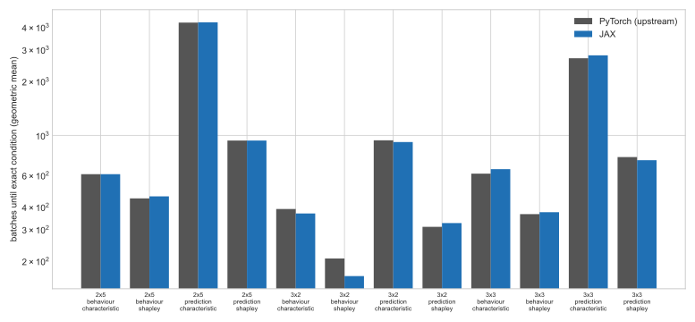

# Quantitative Comparison between PyTorch and JAX explanations of FastSVERL

This report compares the JAX behaviour and prediction explanations with the unchanged PyTorch FastSVERL code at commit `25b2cbe66b0d4a0decc3b63dbc798a79bf2c7d5b`. Both sides train the full agent → characteristic → Shapley pipeline from scratch with the paper's settings. The two implementations use independent random streams, so their agents, buffers and coalitions differ. The comparison is therefore distributional (over 5 seeds), not seed for seed. Deterministic, controlled-input parity of every numerical unit is established separately by the fixture tests described in the [explanations guide](Explanations.md).

## Summary

- **Fidelity:** 29 of 32 comparisons meet the pre-stated acceptance rule, which is a two-sided Welch t-test on log₁₀ of the final exact loss (and, for Hypercube, of the batches until the exact-loss stopping condition) with p ≥ 0.01. The 3 that do not meet it are a known confound in the paper's protocol, explained below. All three pass under the matched protocol (p = 0.59–0.98).
- **Speed (CPU):** steady-state training epochs are **2.7–4.7× faster** in JAX for every stage. DQN agent training is **4.6–6.3× faster**. End-to-end process wall time, including start-up and compilation, is **1.2–1.7× faster**. At this small scale it is dominated by fixed per-process costs.
- **Bugs found by the comparison:**
  - **A settings bug, fixed:** the Hypercube prediction recipe used the wrong Shapley stopping threshold.
  - **An XLA CPU miscompilation, worked around:** see [Findings during validation](#findings-during-validation).

## Setup

| Item | Value |
| --- | --- |
| Machine | Apple M4 Pro, 14 CPU cores, 48 GB, macOS 27.0.1; CPU only |
| JAX side | jax 0.11.0, flax 0.12.8, optax 0.2.8, `JAX_PLATFORMS=cpu` |
| PyTorch side | torch 2.6.0, gymnasium 0.29.1, numpy < 2, Python 3.12, pinned FastSVERL checkout installed in editable mode |
| Seeds | 5 per configuration (paper: 20) |
| Execution | Sequential, one run at a time, on an otherwise idle machine |

**Protocol.** Each domain follows the paper.

- **Gridworld and Mastermind-222:**
  - one DQN agent (seed 1)
  - characteristic seeds 1–5
  - Shapley seeds 1–5, each with and without the exact characteristic as the exact-loss ground truth
- **Hypercube:** cubes 3×2, 3×3 and 2×5 (both kinds). Each seed trains its own agent, characteristic and Shapley model, with the characteristic stopping at exact loss 0.01. The Shapley model stops at 0.001 (behaviour) or 0.01 (prediction), always without the exact characteristic, with `track_batch`.

All settings are the upstream drivers' own dataclass defaults plus their per-domain values, encoded on the JAX side in `experiments/explanations/`.

**Matched protocol.** The paper's protocol has every Shapley seed explain the *first* characteristic. That is fine for producing explanations, but it means the five Shapley seeds share one characteristic. The matched protocol keeps everything else identical and pairs Shapley seed *s* with characteristic seed *s*. Both frameworks run both protocols, labelled `<domain>` and `<domain>-matched`.

**Upstream harness.** Each upstream run script executes unchanged in its own process. Four things in how the scripts are launched differ from upstream's own drivers:

- `import fastsverl.envs` runs first. The committed run scripts never import it, so gym cannot find the registered environments without it (`NameNotFound: Environment GWB doesn't exist`).
- Weights & Biases tracking is off.
- The seed count is reduced.
- `save_explanations` is set to `False`. The Gridworld Shapley arguments omit this field, which the run script reads after training.

Metrics are read back from upstream's TensorBoard logs.

## Fidelity

Values are geometric means over seeds. "Ratio" is JAX ÷ upstream. "Exact char" is the Shapley exact-loss ground truth (`with_exact_char`).

| Environment | Kind | Stage | Exact char | Metric | Upstream | JAX | Ratio | p | Consistent |
| --- | --- | --- | --- | --- | --- | --- | --- | --- | --- |
| gridworld | behaviour | characteristic | — | final exact loss | 0.000109 | 0.000139 | 1.28 | 0.409 | yes |
| gridworld | behaviour | shapley | with | final exact loss | 0.000199 | 0.00012 | 0.61 | 0.000 | **no** (confounded) |
| gridworld | behaviour | shapley | without | final exact loss | 5.25e-12 | 9.13e-12 | 1.74 | 0.867 | yes |
| gridworld | prediction | characteristic | — | final exact loss | 0.128 | 0.092 | 0.72 | 0.215 | yes |
| gridworld | prediction | shapley | with | final exact loss | 0.0742 | 0.0451 | 0.61 | 0.000 | **no** (confounded) |
| gridworld | prediction | shapley | without | final exact loss | 4.76e-09 | 1e-10 | 0.02 | 0.149 | yes |
| gridworld-matched | behaviour | shapley | with | final exact loss | 0.000146 | 0.000141 | 0.96 | 0.937 | yes |
| gridworld-matched | behaviour | shapley | without | final exact loss | 1.22e-11 | 1.24e-11 | 1.02 | 0.995 | yes |
| gridworld-matched | prediction | shapley | with | final exact loss | 0.0758 | 0.0667 | 0.88 | 0.589 | yes |
| gridworld-matched | prediction | shapley | without | final exact loss | 5.74e-10 | 9.05e-10 | 1.58 | 0.885 | yes |
| hypercube-2x5 | behaviour | shapley | without | final exact loss | 0.000736 | 0.000779 | 1.06 | 0.566 | yes |
| hypercube-2x5 | behaviour | shapley | without | batches to stop | 424 | 440 | 1.04 | 0.545 | yes |
| hypercube-2x5 | prediction | shapley | without | final exact loss | 0.0087 | 0.00854 | 0.98 | 0.845 | yes |
| hypercube-2x5 | prediction | shapley | without | batches to stop | 819 | 881 | 1.08 | 0.116 | yes |
| hypercube-3x2 | behaviour | shapley | without | final exact loss | 6.54e-05 | 0.000227 | 3.47 | 0.408 | yes |
| hypercube-3x2 | behaviour | shapley | without | batches to stop | 223 | 165 | 0.74 | 0.063 | yes |
| hypercube-3x2 | prediction | shapley | without | final exact loss | 0.00351 | 0.00312 | 0.89 | 0.739 | yes |
| hypercube-3x2 | prediction | shapley | without | batches to stop | 332 | 318 | 0.96 | 0.545 | yes |
| hypercube-3x3 | behaviour | shapley | without | final exact loss | 0.000761 | 0.000668 | 0.88 | 0.322 | yes |
| hypercube-3x3 | behaviour | shapley | without | batches to stop | 345 | 409 | 1.19 | 0.117 | yes |
| hypercube-3x3 | prediction | shapley | without | final exact loss | 0.0067 | 0.00774 | 1.16 | 0.435 | yes |
| hypercube-3x3 | prediction | shapley | without | batches to stop | 782 | 653 | 0.83 | 0.072 | yes |
| mastermind222 | behaviour | characteristic | — | final exact loss | 0.00191 | 0.00187 | 0.98 | 0.376 | yes |
| mastermind222 | behaviour | shapley | with | final exact loss | 0.00297 | 0.00283 | 0.95 | 0.732 | yes |
| mastermind222 | behaviour | shapley | without | final exact loss | 0.000402 | 0.000426 | 1.06 | 0.797 | yes |
| mastermind222 | prediction | characteristic | — | final exact loss | 0.000612 | 0.000677 | 1.11 | 0.692 | yes |
| mastermind222 | prediction | shapley | with | final exact loss | 0.00135 | 0.000603 | 0.45 | 0.003 | **no** (confounded) |
| mastermind222 | prediction | shapley | without | final exact loss | 0.000561 | 0.000452 | 0.81 | 0.527 | yes |
| mastermind222-matched | behaviour | shapley | with | final exact loss | 0.00292 | 0.00291 | 1.00 | 0.980 | yes |
| mastermind222-matched | behaviour | shapley | without | final exact loss | 0.000406 | 0.000431 | 1.06 | 0.787 | yes |
| mastermind222-matched | prediction | shapley | with | final exact loss | 0.000927 | 0.000787 | 0.85 | 0.651 | yes |
| mastermind222-matched | prediction | shapley | without | final exact loss | 0.000531 | 0.000464 | 0.87 | 0.685 | yes |

**Why the three confounded rows fail.** With the exact characteristic as ground truth, a Shapley model's exact loss is dominated by the error of the characteristic it was trained on. Under the paper's protocol that is one characteristic for all five Shapley seeds. In Gridworld the five with-exact losses within each framework agree to within 0.05% (coefficient of variation below 0.001), so the test compares two single samples of characteristic quality, with spuriously tiny variance. The characteristic comparisons themselves pass, and so do the without-exact-characteristic comparisons, which measure the Shapley fit alone. The matched protocol restores independent replicates, and all of its with-exact comparisons pass.




## Speed

**How each column is measured:**

- **Median epoch:** the median interval between consecutive epoch log entries, which is steady-state compute.
- **Mean epoch:** the whole training loop divided by its epochs. It includes JAX's full-state checkpoints, about 0.1 s each, written every tenth of the epochs. Upstream only saves at the end, so for the 20–80-epoch Gridworld and Mastermind runs this overhead dominates the JAX mean. Hypercube runs stop long before their first checkpoint.
- **Total wall:** each process from launch to exit, summed over seeds. It includes interpreter start-up, imports, buffer collection and, for JAX, compilation. A JAX Hypercube "combined" chain is three processes (agent, characteristic, Shapley); upstream runs them in one.

| Environment | Stage | Upstream median epoch (ms) | JAX median epoch (ms) | Median speedup | Upstream mean epoch (ms) | JAX mean epoch (ms) | Upstream total wall (s) | JAX total wall (s) | Wall speedup |
| --- | --- | --- | --- | --- | --- | --- | --- | --- | --- |
| gridworld | agent | — | — | — | — | — | 27.8 | 4.4 | 6.3× |
| gridworld | characteristic | 18.4 | 5.1 | 3.6× | 18.6 | 31.5 | 65.4 | 39.6 | 1.7× |
| gridworld | shapley | 23.1 | 8.3 | 2.8× | 23.2 | 61.7 | 127.2 | 83.1 | 1.5× |
| gridworld-matched | shapley | 22.9 | 8.4 | 2.7× | 23.3 | 62.2 | 128.7 | 82.3 | 1.6× |
| hypercube-2x5 | characteristic | 27.5 | 6.6 | 4.2× | 28.4 | 6.6 | — | — | — |
| hypercube-2x5 | shapley | 34.4 | 9.7 | 3.5× | 33.8 | 9.7 | — | — | — |
| hypercube-2x5 | combined | — | — | — | — | — | 123.7 | 102.8 | 1.2× |
| hypercube-3x2 | characteristic | 28.3 | 6.0 | 4.7× | 28.3 | 6.1 | — | — | — |
| hypercube-3x2 | shapley | 34.8 | 7.5 | 4.7× | 34.6 | 7.6 | — | — | — |
| hypercube-3x2 | combined | — | — | — | — | — | 121.1 | 89.2 | 1.4× |
| hypercube-3x3 | characteristic | 27.4 | 6.3 | 4.3× | 27.4 | 6.4 | — | — | — |
| hypercube-3x3 | shapley | 33.7 | 8.8 | 3.8× | 33.1 | 8.8 | — | — | — |
| hypercube-3x3 | combined | — | — | — | — | — | 118.7 | 93.0 | 1.3× |
| mastermind222 | agent | — | — | — | — | — | 18.5 | 4.0 | 4.6× |
| mastermind222 | characteristic | 20.3 | 4.6 | 4.4× | 21.7 | 20.2 | 72.5 | 47.6 | 1.5× |
| mastermind222 | shapley | 23.1 | 6.2 | 3.7× | 23.3 | 25.6 | 141.6 | 90.6 | 1.6× |
| mastermind222-matched | shapley | 23.0 | 6.2 | 3.7× | 23.0 | 25.6 | 142.3 | 90.4 | 1.6× |

These are small CPU problems: a 64- or 128-wide MLP and batches of 128. The steady-state gain comes from compiling each whole epoch (batch sampling, coalition sampling, updates, validation and exact loss) into one XLA program instead of per-batch Python and PyTorch dispatch. The larger domains (Mastermind-443 to 463, the 6×5 Hypercube) and GPU execution are where batched compilation should matter most. They are not yet measured here.

## Findings during validation

- **Hypercube prediction stopping threshold (fixed).** Upstream's `hypercube_value.py` stops Shapley training at exact loss 0.01; `hypercube_policy.py` uses 0.001. The first comparison run used 0.001 for both, so JAX prediction Shapley models trained for about twice as many batches and reached 10× lower losses (p < 0.001 on 4 comparisons). The recipe now uses each kind's own threshold, and a full diff of every driver dataclass found no other per-kind differences.
- **XLA CPU miscompilation (worked around).** With jax 0.11.0 on CPU, a jitted network applied to a broadcast-constant batch (here the all-masked null input, `full_like(observations, MASK)`) returns wrong values from about 64 rows. This corrupted the Shapley null value in 2000-row validation batches. The null is now evaluated on one row and broadcast. `tests/test_jit_equivalence.py` checks compiled results against eager evaluation at production batch sizes, and fails on the old implementation. A minimal pure-JAX reproduction:

  ```python
  import jax, jax.numpy as jnp

  k = jax.random.split(jax.random.key(0), 4)
  W1, b1 = jax.random.normal(k[0], (2, 64)), jax.random.normal(k[1], (64,))
  W2, b2 = jax.random.normal(k[2], (64, 64)) / 8, jax.random.normal(k[3], (64,))
  mlp = lambda x, W1, b1, W2, b2: jax.nn.relu(jax.nn.relu(x @ W1 + b1) @ W2 + b2).sum(-1)
  s = jnp.zeros((64, 2))
  print(jax.jit(lambda s, *p: mlp(jnp.full_like(s, -2.0), *p))(s, W1, b1, W2, b2)[0])  # 58.43, wrong
  print(jax.jit(mlp)(jnp.full_like(s, -2.0), W1, b1, W2, b2)[0])  # 68.44, correct
  ```

- **Mastermind exact-loss cost (fixed).** The exact characteristic loss originally evaluated every padded (coalition, unique-observation) slot each epoch: 256 × 8000 rows for Mastermind-222, against a few hundred valid entries. That made JAX characteristic epochs about 1.8× *slower* than upstream. Valid entries are now compacted once and only their chunks are evaluated, giving 4.4× faster epochs.
- **Determinism.** Both sides reproduce bit for bit. The upstream sweep and the unchanged JAX configurations gave identical numbers across repeated full runs.

## Reproduction

From the repository root:

```bash
bash scripts/explanations_port/run.sh                  # both sides, all cases, 5 seeds
bash scripts/explanations_port/run.sh --skip-upstream  # rerun only the JAX side
```

The script clones the pinned FastSVERL commit into a temporary directory and runs `./check.sh`. It then runs `run_jax.py` and `run_upstream.py` sequentially, followed by `compare.py`. Raw losses and timings are written to `docs/data/explanations-port--{jax,upstream}-{runs,timing}.csv`, the tables to `docs/data/explanations-port--{summary,speed}.csv`, and the figures to `docs/figures/explanations-port--*.svg`. Temporary run artifacts are removed on exit.
